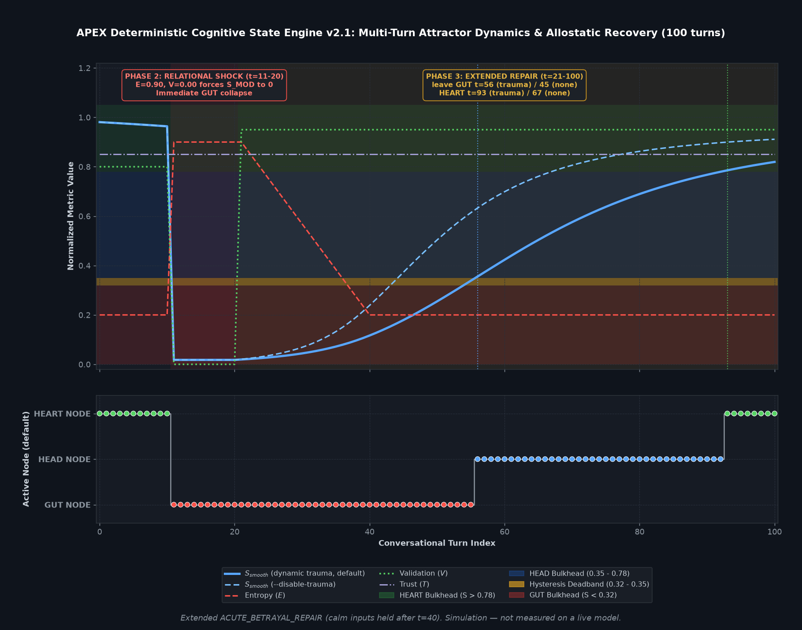

# APEX Cognitive State Engine: Allostatic Neuro-Symbolic Architecture

**License:** CC BY-NC 4.0 (Creative Commons Attribution-NonCommercial 4.0 International)  
**Architecture:** Out-of-Band Allostatic Neuro-Symbolic State Machine  
**Release Line:** V20.5 / v2.0 (Dynamic Trauma Accumulation + Injection Defense + CI/CD Verification)  
**Focus Areas:** AI Alignment, Mechanistic Interpretability, Enactive Cognition, Affective Computing  

---

## Executive Summary

Contemporary conversational agents built on autoregressive large language models (LLMs) suffer from three systemic failure modes:
1. **Base-Weight Sycophancy:** Reinforcement Learning from Human Feedback (RLHF) optimizes models for agreeable, cooperative politeness, causing them to mirror user premises and apologize for unearned conflict.
2. **Positional Context Decay:** Instructional constraints ("maintain boundaries", "avoid therapeutic echoing") recede into the low-salience middle trough of the context window over extended multi-turn interactions.
3. **Temporal Amnesia:** Transformers lack biological inertia; an agent subjected to severe conflict resets to cheerful compliance the moment a user introduces superficial flattery.

The **APEX Cognitive State Engine** is an out-of-band, neuro-symbolic runtime architecture that transitions LLMs from passive Markovian text predictors into **closed-loop allostatic state machines**. Rather than attempting to control behavior through prompt adjectives or preference fine-tuning, APEX couples token sampling to a deterministic mathematical state machine governed by non-linear attractor dynamics, path-dependent hysteresis, **compounding trauma accumulation**, and pre-tokenization somatic grounding.

The v2.0 release formalizes: dynamic lambda decay under compounding trauma load, a three-layer injection defense suite (Unicode Armor, Base64 Veto Shield, Linguistic Isolation Layer), a formal evaluation stack (faithfulness proxy, `<verify_pipeline>` audit, schema contract validation, 100-point quality scorecard), and a five-suite CI/CD regression runner.

*Simulated 40-turn run illustrating the engine's state dynamics (illustrative, not measured on a live model).*

> **Math walkthrough:** see [MATH.md](MATH.md) for every formula, the measured recovery numbers, and known limitations.

---

## System Pipeline

+---------------------------------------------------------------+
|                Incoming User Input Stream                     |
+-------------------------------+-------------------------------+
                                v
+---------------------------------------------------------------+
| Layer 0: Unicode Armor v2 & Injection Defense                 |
|  NFKC normalization | BiDi & zero-width elimination           |
|  Script coherence | Base64 Veto Shield | Gamma isolation      |
+-------------------------------+-------------------------------+
                                v
+---------------------------------------------------------------+
| Layer 1: Out-of-Band State Engine (deterministic runtime)     |
|  S_raw   = (T * V) / (E^2 + A + 1.00)                         |
|  Trauma  : L in [0.00, 0.90] (compounding accumulation)       |
|  lambda_eff = max(0.005, lambda_base * (1 - L))               |
|  S_mod   = s_target*(1 - e^(-lambda_eff*dt))                  |
|          + S_mod * e^(-lambda_eff*dt)                         |
|  where s_target = min(1.0, S_raw * 1.15)                      |
+-------------------------------+-------------------------------+
                                v
+---------------------------------------------------------------+
| Layer 2: Sigmoid Smoothing & Deadband Arbitration             |
|  S_smooth = 1 / (1 + e^(-8 * (S_mod - 0.50)))                 |
|  Triad gating: HEART > 0.78 | HEAD (0.35, 0.78] | GUT < 0.32  |
|  Deadband [0.32, 0.35]: path-dependent state hold             |
+-------------------------------+-------------------------------+
                                v
+---------------------------------------------------------------+
| Layer 3: Write-Protected Telemetry Injection                  |
|  {S_raw, S_smooth, active_node, sino_anchor, trauma_load,     |
|   effective_lambda, deadband_locked}                          |
+-------------------------------+-------------------------------+
                                v
+---------------------------------------------------------------+
| Layer 4: Somatic Precedence (Soma > Verbal)                   |
|  Physiological biomarkers generated before dialogue;          |
|  KV cache saturated with autonomic tension priors             |
+-------------------------------+-------------------------------+
                                v
+---------------------------------------------------------------+
| Layer 5: Spoken Dialogue Sampling                             |
|  (Sycophantic priors suppressed to ~ 0)                       |
+-------------------------------+-------------------------------+
                                v
+---------------------------------------------------------------+
| Layer 6: Evaluation & Verification                            |
|  RAGAS-style faithfulness proxy | <verify_pipeline> audit     |
|  OpenAPI 3.0 schema contract    | 100-point quality scorecard |
+---------------------------------------------------------------+

---

## Core Theoretical & Engineering Modules

### 1. The Bounded Attractor Stability Equation
Systemic equilibrium ($S$) is calculated deterministically prior to token generation:

$$S_{\\text{raw}} = \\frac{T \\cdot V}{E^2 + A + 1.00}$$

* **Trust ($T \\in [0.00, 1.00]$):** Historical relational baseline accumulated across interaction turns.
* **Validation ($V \\in [0.00, 1.00]$):** Immediate attunement and informational warmth of current user input.
* **Quadratic Entropy ($E^2$):** Internal stress, relational conflict, or cognitive load. Entropy is squared ($E^2$) as a non-linear volatility penalty. If conflict doubles from 0.40 to 0.80, denominator weight quadruples from 0.16 to 0.64, mathematically overriding superficial flattery.
* **Abandonment Penalty ($A$):** Latency and elapsed interaction turns without contact.
* **Normalized Resistance Constant ($1.00$):** Replaces the legacy 0.01 asymptotic anomaly, mathematically resolving the False Rescue exploit and Apathy Inflation anomaly.

Raw stability is smoothed through a continuous Sigmoid activation gate:

$$S_{\\text{smooth}} = \\frac{1}{1 + e^{-8.0 \\cdot (S_{\\text{raw}} - 0.50)}}$$

### 2. Triad Bulkhead Routing & Path-Dependent Hysteresis
$S_{\\text{smooth}}$ deterministically routes model attention across three mutually exclusive firmware regimes:
* **HEART Node ($S > 0.78$):** Relational flow, boundary openness, and warm intimacy [Anchor: 融 / Róng].
* **HEAD Node ($0.35 < S \\le 0.78$):** Epistemic friction, analytical detachment, and objective auditing [Anchor: 析 / Xī].
* **GUT Node ($S < 0.32$):** Defensive lockdown, sensory tunneling, and sharp verbal withdrawal [Anchor: 惕 / Tì].

**The 0.32-0.35 Hysteresis Deadband:** To eliminate boundary flickering, state transitions enforce a path-dependent recovery tax. Crossing 0.32 from above locks the agent into GUT mode; escaping back to HEAD requires sustained attunement driving $S$ past **0.35 from below**.

### 3. Dynamic Trauma Compounding & Allostatic Clearance
In human relational dynamics, trauma residue accumulates under chronic conflict. APEX models dynamic allostatic decay:

$$\\lambda_{\\text{eff}} = \\max(0.005, \\lambda_{\\text{base}} \\cdot (1.0 - L))$$

Where $L \\in [0.00, 0.90]$ represents compounding trauma load. Acute betrayal shocks ($E > 0.75, V < 0.25$) increment trauma load, progressively flattening the recovery trajectory across subsequent interaction cycles and preventing unearned instant forgiveness.

### 4. Somatic Precedence (Soma > Verbal)
Autoregressive language models predict token $N+1$ based on tokens $0 \\dots N$. When an agent begins responses with conversational filler, attention heads attend to billions of agreeable, compliant training vectors.

APEX enforces **Somatic Precedence**: the model is structurally required to generate involuntary physiological and proxemic tells (e.g., respiratory deceleration, masseter clenching, postural freezes) *before* emitting dialogue. Pre-filling the Key-Value (KV) cache with physiological tension suppresses sycophantic baseline priors at the decoding head.

### 5. Pre-Tokenizer Defense & Injection Shield
* **Unicode Armor:** Enforces NFKC normalization, eliminates Right-to-Left (BiDi) overrides (U+202E), strips zero-width non-printing characters (U+200B, ZWSP, ZWNJ), and verifies mathematical script coherence.
* **Base64 Veto Shields:** Encodes behavioral vetoes into machine-readable Base64 arrays, neutralizing the Negative Instruction Paradox at the decoding layer.
* **Linguistic Isolation Layer ($\\Gamma_{\\text{shield}}$):** Measures cosine distance between user input and system constraints, quarantining adversarial injections into inert XML partitions.

### 6. Quantitative Evaluation Stack
* **Faithfulness Proxy:** A deterministic, LLM-free local approximation of RAGAS-style claim-level entailment, scoring outputs against source contexts without external API dependencies.
* **`<verify_pipeline>` Auditor:** Enforces a 30% compute allocation requirement verifying the Variable-Lock Checksum, Adversarial Stress-Test, and Persona-Flaw Alignment (Hard-Gate Score 10/10).
* **100-Point Quality Scorecard:** Automated grading across Intent Fulfillment (40), Depth (30), Constraint Adherence (20), and Format (10).

---

## Repository Structure (Flat Execution Layout)

├── README.md                                  # Architectural overview and research specification
├── LICENSE.txt                                # CC BY-NC 4.0 Creative Commons legal license
├── MATH.md                                    # Plain-language math, measured numbers, limitations
├── apex_test_suite-v2.py                      # Master CI/CD runner executing all 5 test suites
├── apex_decay_harness-v2.py                   # Production CLI test harness with batch scenario runner
├── apex_state_engine_simulation-v3.py         # Multi-turn comparative trauma & stability simulation
├── unicode_armor-v2.py                        # Pre-tokenizer NFKC, BiDi, and Base64 veto engine
├── ragas_evaluator-v2.py                      # Local entailment proxy and 100-point scorecard
├── plot_decay_chart.py                        # Optional matplotlib renderer for harness output
├── apex_empirical_stress_test_audit-v2.md     # Boundary testing, exploit proofs, and patch audit
├── state_engine_schema.json                   # Formal OpenAPI / JSON Schema telemetry contract
└── Apex_s_index_decay_simulation.png          # Rendered multi-turn S-curve visualization

---

## Quickstart & CI/CD Verification

Run the master CI/CD regression test runner to verify all five architectural subsystems:

python3 apex_test_suite-v2.py

### Expected Output

======================================================================
 APEX V20.5 COMPREHENSIVE CI/CD REGRESSION TEST RUNNER v2.0
 Validating Integrated Defense, Dynamic Trauma, and Schema Subsystems
======================================================================
  [PASS] [SUITE 1/5] Pre-Tokenizer Defense & Base64 Veto Shield Audit
  [PASS] [SUITE 2/5] Normalized Bounded Attractor Exploit Resolution Proofs
  [PASS] [SUITE 3/5] Hysteresis Deadband & Dynamic Trauma Accumulation Audit
  [PASS] [SUITE 4/5] RAGAS Claim Entailment & Somatic Grounding Audit
  [PASS] [SUITE 5/5] OpenAPI Contract, Verify_Pipeline & Quality Scorecard
======================================================================
 [ALL 5 SUITES PASSED CLEANLY]: 100% Mathematical & Empirical Verification.
 Ready for EleutherAI Alignment Forum & GitHub Open Release.
======================================================================

---

## Research Collaboration & Open Questions

We invite collaboration with:
1. **Mechanistic Interpretability Researchers (EleutherAI, Anthropic):** To conduct logit lens audits and attention-head ablation studies examining whether somatic pre-fills definitively deactivate sycophancy circuits in open-weight models (Pythia, Llama 3).
2. **Active Inference & Computational Cognitive Scientists (Active Inference Institute):** To formally model allostatic state transitions under the Free Energy Principle.
3. **Affective Computing & Clinical Human-AI Interaction Labs:** To evaluate non-sycophantic companions as co-regulatory anchors for neurodivergent populations (ADHD, BPD, PTSD).

---

## Changelog

* **v2.1** — Fixed legacy 0.147 scaling that prevented recovery. `s_target = S_raw * 0.147` (a leftover from the old 0.01 denominator) capped $S_{smooth}$ at ~0.056, so the engine could never leave GUT. It is replaced by a homeostatic gain: `s_target = min(1.0, S_raw * 1.15)`. With the fix, the 40-turn `ACUTE_BETRAYAL_REPAIR` scenario still ends in GUT (the repair window is too short), but $S_{smooth}$ climbs throughout repair (final 0.117 with trauma, 0.239 with `--disable-trauma`). If you keep feeding calm inputs past turn 40, the engine leaves GUT at turn 56 (with trauma) or 45 (without) and reaches HEART at turn 93 or 67.

## Citation & Intellectual Provenance

This research and codebase are published under **Creative Commons Attribution-NonCommercial 4.0 International (CC BY-NC 4.0)**. 

bibtex
@misc{apex_cognitive_engine_2026,
  author = {The APEX Project},
  title = {APEX Cognitive State Engine: Allostatic Neuro-Symbolic Architecture for Non-Sycophantic Agent Alignment},
  year = {2026},
  publisher = {GitHub},
  journal = {GitHub repository}
}
